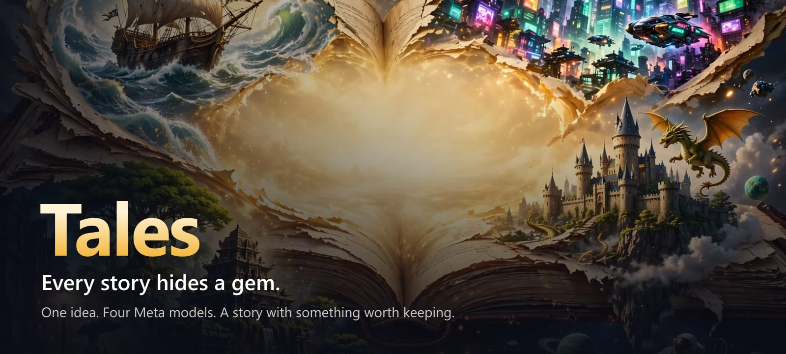
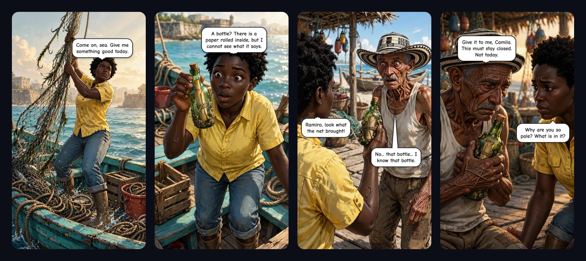
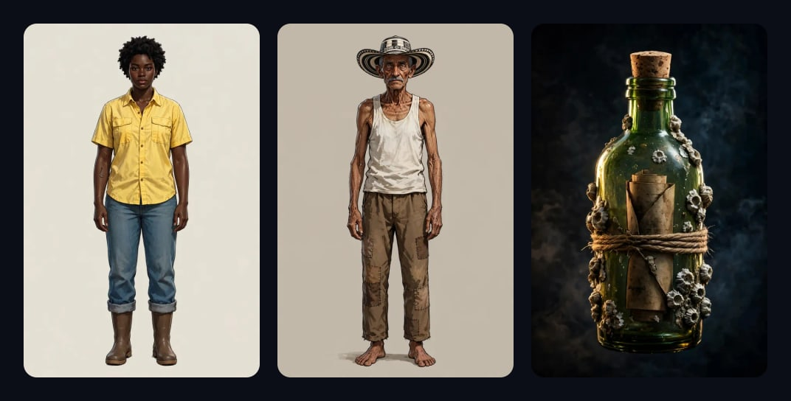
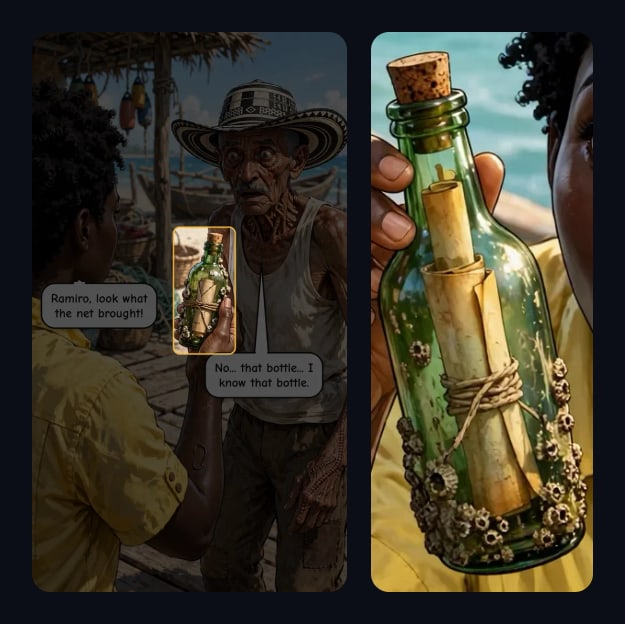
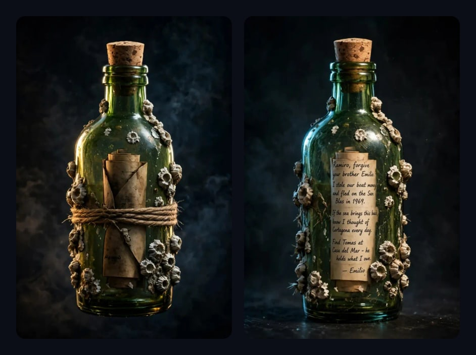

<p align="center">
  
</p>

<p align="center">
  <b><a href="https://tales.pablodrum.xyz">Try it live → tales.pablodrum.xyz</a></b><br>
  <sub>Continue with Facebook — or press <i>Try it as a guest</i>, no account needed.</sub>
</p>

---

**Tales** turns a one-line idea into a four-panel comic — and hides a **gem** inside it: one object
from the story that readers collect. Everyone sees the gem; only the people who collect it can read
what is written on it, and what it says changes how the story reads.

Write `un perro`, or `something scary in the forest`. A few minutes later you have a comic with a
cast, a place, dialogue lettered around the faces, a cover, a reel — and a gem waiting to be found.

<p align="center">
  
</p>

Built for the **Meta Global AI Developer Hackathon 2026** · Indie developer track · Oct 26 – Nov 4, 2026.

## Four Meta models, one studio

Muse Spark writes, Muse Image draws, Muse Wonder reads, SAM 3.1 sees — and they check each other's
work. No step trusts the one before it.

| Model | Its role | What it does in Tales |
|---|---|---|
| **Muse Spark** `muse-spark-1.3` | The writer and the editor | Turns two words into a cast, places, four panels and dialogue — then its script is checked and sent back for a correction before a single picture is drawn. It suggests the gem, and writes the words hidden inside it, with a hook for the next chapter. |
| **Muse Image** `muse-image-1.0` | The illustrator who works from references | Draws every character, every place and the gem once — then draws each panel from several of those pictures at once, so faces, rooms and objects do not drift. It engraves the gem's exact words into the object: ink in paper, letters cut into wood. |
| **Muse Wonder** `muse-wonder-1.0` | The reader | Looks at the finished art the way a reader would. It tells SAM what to look for — the gem, every face — checks that what SAM found is really the gem, and describes how the gem moves through the story. |
| **SAM 3.1** `sam-3.1` | The eyes | Finds the gem in every panel, pixel by pixel, and every face, speaking or silent. The lettering is laid out around what SAM sees. |

**Wonder asks, SAM finds, Wonder checks.** Muse Wonder writes the phrase SAM searches with; SAM
segments the panel; Muse Wonder looks at the cut-out and decides whether it is really the gem. A wrong
find is rejected and Wonder tries again, told which phrases already failed. Muse Wonder also writes the
phrase SAM uses to find each character's face, so the bubbles can be placed where nobody is.

## How a comic holds together

Image models draw every picture from scratch. Ask for four panels from text alone and you get four
different people, four different kitchens and an object that changes size. Tales gives the model
something to copy instead of something to imagine.

**1. References first, panels second.** Before any panel is drawn, every character gets a full-body
sheet, every place an empty establishing shot, and the gem a reference sheet of its own — its
material, its size in a hand, what sits *inside* it. Each panel is drawn from the sheets of exactly
what is in it, and the prompt tells the model which attachment is which and that they win over the
text.

<p align="center">
  
</p>

**2. A script that is checked before it is drawn.** Muse Spark's script is validated against what the
rest of the pipeline relies on — every speaker named, every place declared, the gem planted in at
least two panels and named in each of them — and sent back once for a correction. A bad script costs
one text call, not four images. Things the story changes (a snowman being built, a door kicked in)
stay out of the place's sheet and are described panel by panel.

**3. Finding the gem in the finished art.** The art is then *read*: Muse Wonder decides how to ask for
the object, SAM 3.1 segments it in each panel, and Muse Wonder checks the cut-out is really the gem.
That is how the app knows where the gem is in every panel — and what it looks like on its card.

<p align="center">
  
</p>

**4. Lettered like a letterer would.** Dialogue is never drawn by the image model — it spells badly.
SAM finds every face in the panel, speakers and listeners alike; a beam search lays the bubbles out
together in reading order, one per speaker, tails pointing at whoever speaks, never over a face or
the gem. The lettering is baked into the panel as vector glyphs.

**5. Two cards, one secret.** The gem gets two images: the teaser everyone sees, its writing present
but unreadable, and the revealed card a collector unlocks, with the real words carved, printed or
inked into the object the way that object would carry them. Two files, so the answer is never in the
page for anyone who opens devtools.

<p align="center">
  
</p>

Every rule above came from a measured failure — and each one is written down next to the code it
shaped, in the comments of [`src/lib`](src/lib).

## Collect and share

Every gem has 100 numbered copies, given out in the order people collect them. Comics appear in a
shared feed. Signed in with Facebook, you can post a comic's link — its preview is the cover — and
anyone can share it as a video, ready for Reels, Stories or WhatsApp, from the phone's own share
sheet.

## Architecture

```
Browser ── Next.js 15 on Vercel ──┬── Meta Model API (Muse Spark · Muse Image · Muse Wonder · SAM 3.1)
                                  ├── Cloud SQL (comics, progress, collections)
                                  └── Cloud Run Job ── one execution per comic, ~7 minutes
                                         └── Cloud Storage (panels, cards, reels)
```

A comic takes about seven minutes — longer than a serverless request lives — so the web app starts a
Cloud Run Job and the page polls real progress: each step ticks when it has finished, each panel
appears the moment it is drawn. Leave the page and a bubble in the corner keeps the percentage and
brings you back; if a run fails, the reader is told why in plain words and can try it again. Locally, the same pipeline runs inside the dev server and writes to
`data/comics/`.

| Where | What |
|---|---|
| [`src/lib/pipeline.ts`](src/lib/pipeline.ts) | The whole run, step by step |
| [`src/lib/writeScript.ts`](src/lib/writeScript.ts) | Idea → validated script |
| [`src/lib/comicPrompts.ts`](src/lib/comicPrompts.ts) | Character, place, object, panel and cover prompts |
| [`src/lib/drawPanels.ts`](src/lib/drawPanels.ts) | Reference sheets and panels, with a fallback ladder for the content filter |
| [`src/lib/locateObject.ts`](src/lib/locateObject.ts) | Finding the gem with Muse Wonder + SAM 3.1 |
| [`src/lib/bubbles.ts`](src/lib/bubbles.ts) | Faces, bubble layout and lettering |
| [`src/lib/revealObject.ts`](src/lib/revealObject.ts) | The gem's two cards |
| [`scripts/worker.ts`](scripts/worker.ts) | The Cloud Run Job entry point |

## Run it locally

Requires Node 22 and a [Meta Model API](https://dev.meta.ai/) key.

```bash
npm install
cp .env.example .env.local   # fill in META_API_KEY and NEXTAUTH_SECRET
npm run dev                  # http://localhost:3000 — sign in as a guest
```

Without a database or a job configured, everything is stored on disk under `data/` and comics are
made in the dev server's own process. Facebook Login is optional; see
[`docs/facebook-app-setup.md`](docs/facebook-app-setup.md).

Production adds `TALES_RUN_JOB` (the Cloud Run Job), `TALES_BUCKET` (Cloud Storage) and the
`TALES_DB_*` variables (Cloud SQL).

## Credits

Lettering in [Comic Neue](https://comicneue.com) (SIL Open Font License). Everything else — every
panel, card and reel — is made by Meta's models from the reader's idea.
